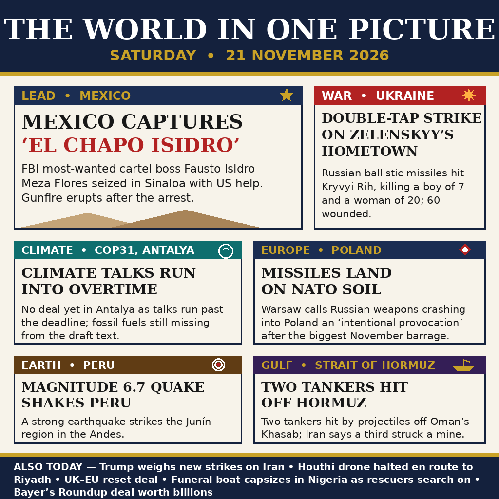

# 🗞️ The World in One Picture — 21 November 2026


One poster, the whole day: a programmatically generated 1024×1024 news infographic — the edition of **Saturday 21 November 2026**.



## 🧩 What's on the poster

- **Lead story:** Mexico captures "El Chapo Isidro" — FBI most-wanted cartel boss Fausto Isidro Meza Flores seized in Sinaloa with US help.
- **War:** a double-tap ballistic strike on Kryvyi Rih, Zelenskyy's hometown — a boy of 7 and a woman of 20 killed, 60 wounded.
- **Climate:** COP31 talks in Antalya run into overtime with no deal yet; fossil fuels still missing from the draft text.
- **Europe:** Russian weapons crash into Poland; Warsaw calls it an "intentional provocation".
- **Earth:** a magnitude 6.7 earthquake shakes Peru's Junín region.
- **Gulf:** two tankers hit by projectiles off Oman's Khasab in the Strait of Hormuz; Iran says a third struck a naval mine.
- A headline ticker along the bottom edge: Trump weighing new strikes on Iran, a Houthi drone halted en route to Riyadh, the UK–EU reset deal, the Nigeria funeral-boat disaster, and Bayer's Roundup settlement.

## 📏 Results

- Poster: 1024×1024 PNG, 146,138 bytes.
- Fully deterministic: repeated runs of the drawing script produce byte-identical files (verified with `cmp`).

## 🛠️ How it works

`draw_poster.py` lays out the entire poster in code (Pillow): panels, typography, colour system — no design tools, fully deterministic output. `main.ts` copies the finished `poster.png` to the output directory.

## 🚀 Run

```bash
python3 draw_poster.py        # writes poster.png
mkdir -p out && OUTPUT_DIR=out node main.ts
```

## 👤 Author

**Kamal Mosadegh** — freelance developer · [Portfolio](https://kamalmosadegh.github.io) · kamalmosadegh6977@gmail.com

MIT licensed.
